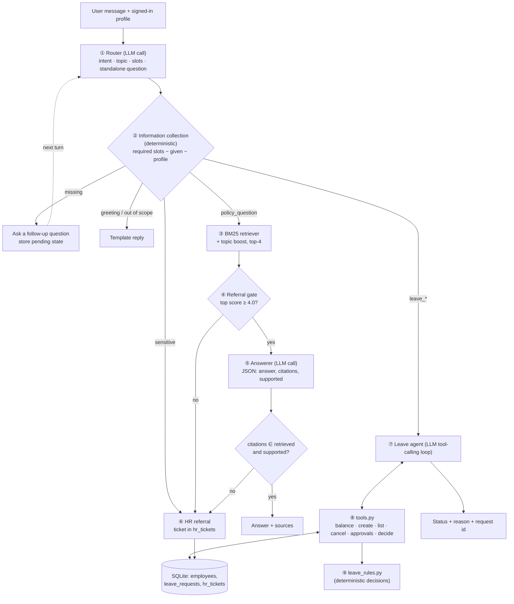

# Brightpath HR Assistant: Report (NLP Assignment 1)

An HR assistant for a fictional company (Brightpath Analytics, offices in Riga and Lisbon). It answers policy
questions with cited sources, asks for missing information, refers questions it can't support to HR, and
manages leave requests in a database that only the LLM's tool calls can reach. The work followed CRISP-DM;
each section below is one phase, and the iteration history is in [`crisp_dm_log.md`](crisp_dm_log.md).

---

## 1. Business understanding

### 1.1 Problem and users
Employees ask HR the same questions again and again (leave days, sick notes, benefits), and the answers
depend on who is asking: office, employment type, caregiver role. HR wants instant, **sourced** answers,
leave requests that follow the rules, and people sent to a human when the policies are silent or the topic is
sensitive. Users: employees, managers (approve team leave), and HR (sees the tickets).

### 1.2 Requirements in scope
| # | Requirement | Implemented by |
|---|---|---|
| R1 | Understand what the user wants (policy question, leave action, sensitive, other) | Router (LLM) |
| R2 | Collect the information needed to answer: ask follow-ups for missing slots, use the profile when signed in | Router + `topics.py` slot schema + info-collection step |
| R3 | Retrieve the relevant policy section | BM25 retriever + topic boost |
| R4 | Answer only from the policies and identify the source | Answerer (LLM) + citation validation |
| R5 | Route to HR when the policies don't support an answer, or the topic is sensitive | BM25 gate + `supported` flag + ticket in DB |
| R6 | Employees request, view, and cancel leave; managers approve or decline | Leave agent (LLM tool calling) |
| R7 | Leave data lives in a DB and is accessed **only via the LLM** (tools) | `tools.py`; the web API has no leave endpoints |
| R8 | Leave approve/decline follows company rules | `leave_rules.py` (deterministic) |

**Out of scope:** real HRIS integration, authentication (a profile picker stands in for login), multi-language, document upload.

### 1.3 Success criteria (chosen before building)
| Component | Metric | Target |
|---|---|---|
| Router | intent accuracy, topic accuracy | ≥ 0.90 |
| Information collection | follow-up precision/recall, missing-slot exact match, slot value accuracy | ≥ 0.85 |
| Retrieval | Recall@3 / Recall@4, MRR | ≥ 0.90 / ≥ 0.80 |
| Answer correctness | key-fact recall, LLM-judge correctness (1–5) | ≥ 0.85 / ≥ 4.0 |
| Source support | citation precision, LLM-judge faithfulness (1–5) | ≥ 0.90 / ≥ 4.5 |
| HR referral | precision, recall, F1 | ≥ 0.85 |
| Leave agent | tool selection, argument accuracy, final DB status accuracy | ≥ 0.90 |
| Leave rules | decision accuracy on gold arguments | 1.00 |

---

## 2. Data understanding

**Existing datasets checked** (Hugging Face, Nov 2026): `syncora/hr-policies-qa-dataset` (synthetic chat QA, no
source documents), `adarsh-08/hr-policy-dataset` (instruction/response pairs), `Jainamshahhh/hr-ops-tools`
(tool-use tasks), `Karmane/enterprise-rag-internal-knowledge-search-benchmark` (gated, generic). None gives
a policy corpus, questions labelled with the source section, and an employee/leave database that all agree
with each other, and that agreement is what citation checks and DB-outcome checks need. So the data is synthetic and
written for this project:

| Data | Size | Notes |
|---|---|---|
| `data/policies/*.md` | 8 policies, 51 chunks (43 numbered sections + 8 intros) | annual, sick, parental, other leave + holidays, onboarding, benefits, remote work, expenses/payroll. Facts differ by office and employment type on purpose. |
| `data/seed.json` | 7 employees, 3 leave requests, 2026–27 holiday calendars | Covers a full-timer, a part-timer (0.6 FTE), a new joiner in probation, a contractor, 2 managers, and HR. |
| `eval/cases.jsonl` | 61 labelled cases | 26 answerable QA, 9 should-refer (incl. 1 sensitive), 3 out-of-scope/greeting, 6 multi-turn collection, 17 leave (incl. permission and guest cases). |

---

## 3. Data preparation
- **Chunking:** one chunk per `## N.` section (each section was written to stand alone), id `doc#n`, so citations are stable and readable.
- **Tokenisation for BM25:** lowercase, stop-word removal, light suffix stemming, section title weighted ×2, a small synonym table for employee vocabulary (vacation→annual leave, doctor's note→medical certificate…).
- **Slot normalisation:** the LLM's slots are validated against fixed value sets (`topics.SLOT_VALUES`); dates are parsed as ISO; invalid values are dropped and recorded in the trace.
- **DB seeding:** `python -m hr_assistant.db --reset`; working days are computed with each office's public holidays.

---

## 4. Modeling: system architecture

### 4.1 Data flow

Every step writes a trace span (input, output, latency; LLM calls with full prompt, model, tokens, cache hit),
which is shown in the UI's Trace panel and appended to `logs/traces.jsonl`.

### 4.2 Components
| # | Component | Purpose | Input → Output | Model / tool call |
|---|---|---|---|---|
| ① | Router `router.py` | Understand the request; rewrite follow-ups into a standalone question | message, last 6 turns, pending state → `{intent, topic, slots, standalone_question}` | 1 LLM call (JSON) |
| ② | Info collection `agent.py` + `topics.py` | Decide whether we can answer yet; merge follow-up answers | intent, topic, slots, profile → missing slots / proceed | none (rules) |
| ③ | Retriever `retriever.py` | Find candidate policy sections | question + slot words, topic → top-4 chunks with scores | none (BM25) |
| ④ | Referral gate | Skip generation for clearly unrelated questions | top score → pass/refer | none |
| ⑤ | Answerer `answerer.py` | Grounded answer tailored to the employee, with citations | question, chunks, employee details → `{answer, citations, supported}` | 1 LLM call (JSON) |
| ⑥ | HR referral | Hand over to a human; record it | question, reason → ticket id | DB write |
| ⑦ | Leave agent `leave_agent.py` | Turn a leave request into tool calls and explain the result | message, slots, history → reply + tool calls | 1–5 LLM calls with tools |
| ⑧ | Tools `tools.py` | The only access path to leave data; enforces identity and permissions | tool name + args → JSON result | SQLite |
| ⑨ | Rules `leave_rules.py` | Approve / decline / pending, matching the written policies | employee, type, dates, balance, overlap → decision + reason | none |

**Why these choices.** BM25 instead of embeddings: the corpus is small and its vocabulary is precise, BM25
scores can be explained in the demo, nothing has to be downloaded, and the top score doubles as a
"is anything relevant?" signal. Approvals are deterministic because an approval must be auditable and
can't vary from run to run; the LLM only picks tools and phrases the outcome. The employee id is bound from the session, not
taken from LLM arguments, so prompt injection ("approve my own request as Laura") cannot impersonate anyone.
**Model:** Claude Haiku 5.5 (`claude-haiku-5-5`) through the official Anthropic SDK, chosen as the cheapest current Claude
model ($0.10 / $0.50 per 1M tokens): routing, slot extraction, short grounded answers, and a handful of tool calls don't
need a larger model. Thinking is disabled because each step is a short JSON or tool call. Claude 5.x models don't take a
`temperature` parameter, so all responses are cached on disk instead, which makes evals reproducible and free to re-run.
The same model acts as the judge (the cheapest option). The risk of self-preference bias is checked with judge calibration
(§5). OpenRouter free models remain available as a configuration switch (`HR_PROVIDER=openrouter`).

### 4.3 Walkthrough: one input through the system
*Guest asks "How much parental leave can I take?"*
1. **Router** → `{intent: policy_question, topic: parental_leave, slots: {}}`.
2. **Info collection**: `parental_leave` requires `caregiver_role` and `employment_type`; neither is known (guest) → reply with two
   follow-up questions and store `pending`.
3. User: "I'm the primary caregiver and I work full-time." → **Router** → `provide_info`, slots `{caregiver_role: primary,
   employment_type: full_time}`, standalone question "How much parental leave does a full-time primary caregiver get?"
4. **Info collection** merges the pending state → nothing missing.
5. **Retriever** query = question + "primary full time" → `parental_leave#2` ranked first (topic boost ×1.3).
6. **Gate**: top score ≥ 4.0 → pass. **Answerer** returns "16 weeks (80 working days) fully paid… [parental_leave#2]", `supported: true`.
7. Citation validated (it was retrieved) → reply with "Sources: Parental Leave Policy, §2 Parental leave entitlement".

*Anna (E001) says "Book annual leave from 7 to 11 December"* → router `leave_request` with ISO dates → the leave agent
calls `create_leave_request(annual, 2026-12-07, 2026-12-11)` → `tools.py` computes 5 working days, 13 available, 21 days' notice,
no overlap → rules: **approved** → row in `leave_requests` → the agent replies with the status and the request id.

---

## 5. Evaluation

Run: `python -m eval.run_eval --offline` (no LLM) and `python -m eval.run_eval --calibrate-judge` (full).
The full report is generated into [`results/eval_report.md`](../results/eval_report.md); raw outputs are in `results/per_case.jsonl`.

### 5.1 Metric choice (why these metrics)
- **Router:** intent/topic accuracy plus a confusion list, because a wrong intent sends the request down the wrong pipeline.
- **Information collection:** asking or not asking is a binary decision, so precision (don't pester people who
  already gave the info) and recall (don't answer without the needed info) are reported separately. Missing-slot exact
  match checks that we ask for the *right* things; slot value accuracy checks extraction after the follow-up.
- **Retrieval:** Hit@1, Recall@k (k=4 is what the answerer sees), MRR. Measured twice: on the gold question
  (offline, isolates the retriever) and on the router's rewritten question (online, end-to-end).
- **Answer correctness:** deterministic **key-fact recall** (exact numbers such as "25", "16") plus an **LLM judge** score (1–5)
  against a reference answer. Key facts are objective but narrow; the judge catches wrong framing (e.g. a contractor told they
  get 25 days).
- **Source support:** **citation precision/recall** against labelled sections, plus **judge faithfulness**: is every claim
  supported by the *cited* text?
- **Referral:** precision/recall/F1 on `should_refer`, with the false and missed referrals listed by id.
- **Leave agent:** tool selection, exact argument match, and **final DB status** (the outcome that matters, checked in the DB, not in the reply text).
- **Judge calibration:** the judge scores the reference answer and a corrupted copy (numbers shifted). A judge that can't
  separate them is useless, so we report pairwise accuracy and the mean score gap.

### 5.2 Results: offline components (no LLM, reproducible)
| Component | Metric | Value |
|---|---|---|
| Retrieval (BM25, gold question, n=32) | Hit@1 / Recall@3 / Recall@4 / MRR | 0.906 / 1.000 / 1.000 / 0.943 |
| Retrieval (BM25 + topic boost) | Hit@1 / Recall@3 / Recall@4 / MRR | 0.906 / 1.000 / 1.000 / 0.948 |
| Referral gate | AUC (answerable vs. should-refer, top BM25 score) | 0.965 |
| Referral gate @ 4.0 | precision / recall / answerable blocked | 1.00 / 0.375 / 0 |
| Leave rules (gold args, n=11) | decision accuracy | 1.000 |

**Reading the numbers.** Retrieval is near the ceiling, partly because the corpus and questions were written by the same
author (an optimistic bias; see §7). The three Hit@1 misses (qa04, qa26, col04) rank the right section 2nd or 3rd
because neighbouring sections of the same document share vocabulary. The answerer sees the top 4, so this doesn't
hurt answers. The gate on its own catches only 3/8 unanswerable questions: near-misses such as "salary band" or
"phone plan" share words with real sections (payroll, lost phone), so their BM25 score is high. That's why the gate is
deliberately conservative (no answerable question blocked) and the answerer's `supported` flag does the rest. The
end-to-end referral F1 below measures the combination.

### 5.3 Results: LLM components
Run on 2026-11-15 with `claude-haiku-5-5` (assistant and judge), all 61 cases, `python -m eval.run_eval --calibrate-judge`.
Full output: [`results/eval_report.md`](../results/eval_report.md).

| Component | Metric | Value | Target | |
|---|---|---|---|---|
| Router (n=61) | intent acc / topic acc | 1.000 / 0.980 | ≥ 0.90 | ✅ |
| Info collection | follow-up P / R / F1 | 1.000 / 1.000 / 1.000 | ≥ 0.85 | ✅ |
| Info collection | missing-slot exact match / slot value acc | 1.000 / 1.000 | ≥ 0.85 | ✅ |
| Retrieval (end-to-end, n=32) | Hit@1 / Recall@4 / MRR | 0.906 / 1.000 / 0.953 | ≥ 0.90 / 0.80 | ✅ |
| Answer (n=32) | key-fact recall / judge correctness / judge ≥4 | 1.000 / 4.875 / 1.000 | ≥ 0.85 / 4.0 | ✅ |
| Source support | citation precision / citation recall | **0.854** / 1.000 | ≥ 0.90 | ⚠️ |
| Source support | judge faithfulness mean / share = 5 | 4.531 / **0.688** | ≥ 4.5 | ⚠️ borderline |
| Referral (n=44) | precision / recall / F1 | 1.000 / 1.000 / 1.000 | ≥ 0.85 | ✅ |
| Leave agent (n=17) | tool acc / args acc / final DB status acc | 1.000 / 1.000 / 1.000 | ≥ 0.90 | ✅ |
| Judge calibration (n=31) | pairwise acc / mean correct vs corrupted | 1.000 / 4.97 vs 1.16 | ≥ 0.9 | ✅ |
| Latency | mean per case / router / answerer / leave agent | 2.2 s / 1.0 s / 1.0 s / 1.8 s | — | |

**Error analysis (why the scores aren't higher):**
- **Faithfulness 4.53, only 69% perfect.** In all 10 cases below 5, the answer repeats an *employee detail* ("as a
  full-time employee", "in Riga") that comes from the profile we pass to the answerer, not from the cited policy text.
  The judge only sees the cited text, so it marks the detail as unsupported (qa12, qa20, qa22…). The facts are true,
  but the answer mixes two sources and cites only one. Fix: tell the answerer to mention a profile detail only when it
  changes the answer, and pass the profile to the judge as a second labelled source. The two worst cases (qa06, qa20 = 2)
  add a claim that applies the rule to the user's own situation.
- **Citation precision 0.854.** The answerer often cites a neighbouring section of the same policy as well (e.g. the intro
  `#0` or `sick_leave#4` next to `#2`). Recall is 1.0, so the right section is always cited; the extra ones are mostly harmless
  context. Part of this is labelling: gold lists only the one *necessary* section. Fix: an instruction to cite only sections
  that contain a stated fact.
- **Topic 0.980:** one miss. qa22 "meal allowance" was routed to `expenses_travel` instead of `wellness_learning`. That's
  defensible, and it didn't hurt the answer, because retrieval still found `benefits#6`.
- **Referral gate:** online, the BM25 gate caught **none** of the 8 unanswerable questions. The router's rewritten question
  is longer, so every top score was ≥ 4.3. All 8 were caught by the answerer's `supported=false`, which shows why the second
  layer exists. The gate only saves an LLM call on truly unrelated input.
- **Caveat: scores near 1.0 are optimistic.** Policies, questions, and labels were written by one author with a consistent
  vocabulary, and the cases are single-intent. A harder set (paraphrases by someone else, multi-intent messages, typos,
  ambiguous dates) is the next step before trusting these numbers. The judge is the same model as the generator (the cheapest
  option), but calibration shows it clearly separates correct from corrupted answers (31/31).

**Where to look if scores drop on a harder set** (use the failure lists in the report):
- *Intent confusions* `policy_question ↔ leave_request` ("Can I take leave on Friday?") → add contrastive examples to `ROUTER_SYSTEM`.
- *Follow-up false positives* → a slot the user implied wasn't extracted (e.g. "my grandma" → `other_relative`): improve the slot descriptions.
- *Low faithfulness with high correctness* → the model adds general knowledge; tighten `ANSWER_SYSTEM` or lower the word limit.
- *Missed referrals* → the model answered from a loosely related section; the fix is a second "does this excerpt answer exactly this
  question?" check, or raising the gate threshold for topic `other`.
- *Leave argument errors* are usually date resolution (missing year, "next Friday") → put explicit date examples in the router prompt, or
  resolve dates in code.

---

## 6. Deployment
Local web app: FastAPI (`app/server.py`) and one static page (`app/static/index.html`) with a profile picker, chat,
tags (intent, slots asked, sources, tool status, ticket), and a **Trace panel** that shows every component's span and the
raw LLM prompts. Run instructions are in the [README](../README.md).

---

## 7. Use of the AI coding assistant
- **`AGENTS.md`** (the single source of truth; `CLAUDE.md` imports it): purpose, the CRISP-DM process with a phase per change,
  a repository map so the agent reads only the files it needs, **architecture invariants** (leave data only via `tools.py`; identity
  from the session; approvals in rules; prompts only in `prompts.py`; citations must be retrieved), code conventions, a definition of done
  (tests + eval + report + log), and context-hygiene rules (don't read caches; respect free-tier limits).
- **Skills** (`.claude/skills/`): `crisp-dm-iteration` (phase, baseline, change, re-eval, log), `add-policy` (format the chunker
  depends on, keep rules and text in sync), `add-eval-case` (label schema and rules), `run-evals` (commands, healthy ranges,
  upstream-vs-component error analysis), `debug-trace` (find the failing span).
- **Feedback loops:** offline pytest with a scripted fake LLM (18 tests) and the offline eval give the agent a fast,
  free signal; the CRISP-DM log records every iteration with its numbers before and after (example: the "vacation days" retrieval fix
  and its Hit@1 trade-off).

## 8. Limitations and next steps
- Synthetic corpus and labels by one author → optimistic retrieval scores. Next: have a second person write paraphrased
  questions, or sample real phrasing from the public HR QA sets.
- 61 cases → wide confidence intervals (one case ≈ 3 points on a 32-case metric).
- Free models change and are rate-limited; results are tied to the model id recorded in `results/metrics.json`.
- No authentication; the profile picker is a stand-in.
